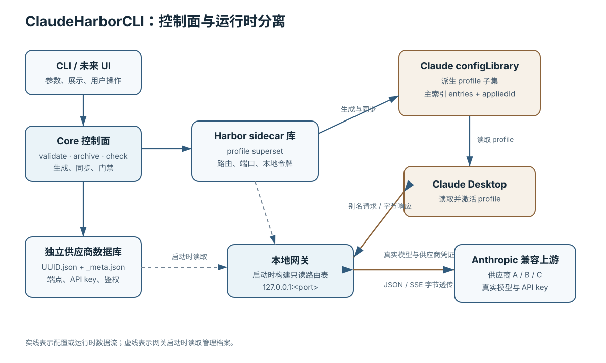
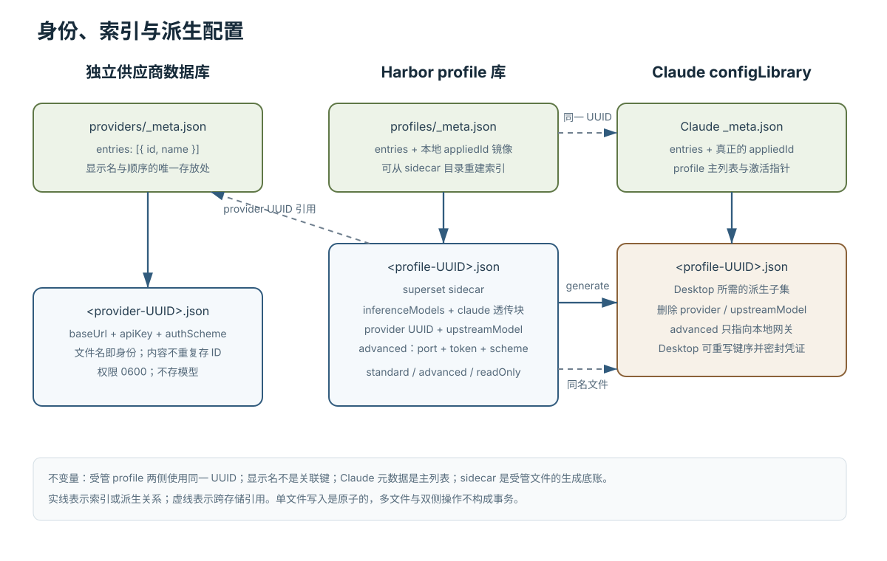
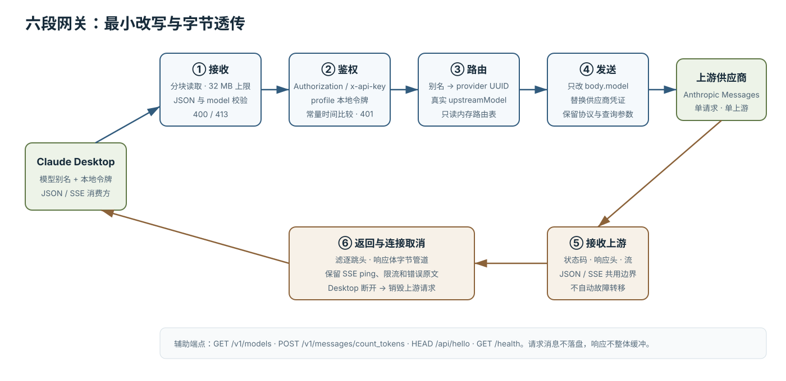

# ClaudeHarborCLI 架构说明

**版本：0.1.2 · 平台：macOS / Windows · 协议边界：Anthropic Messages**

本文档描述当前代码实际采用的架构。README 用于说明项目问题、核心方法和验证结论；本文进一步定义组件职责、数据所有权、文件管理规则、生命周期算法、运行时链路和演进约束。

## 1. 设计问题与目标

Claude Desktop 的第三方 inference profile 同时承担客户端连接参数和模型目录，但它不表达完整的多供应商管理模型。真实上游模型、供应商引用、网关运行参数和本地凭证如果全部混入该文件，就会使客户端消费格式与管理格式耦合。ClaudeHarborCLI 的首要目标是把这两种职责分离：供应商连接信息独立存储，profile 的管理信息存入 Harbor sidecar，Claude profile 由 sidecar 生成，运行时网关只消费启动时确定的路由表。

第二个目标是保留模型名称的档位语义。客户端工作流可能利用 `haiku`、`sonnet`、`opus` 等名称选择不同任务档位，因此路由别名不能完全随机化。系统允许用户在一个 profile 中自由定义多个可读别名，并将每个别名显式绑定到一家供应商的一个真实模型。第三个目标是使配置生命周期可检查：哪些 profile 存在、哪一个已激活、Claude 文件是否与本地生成期望一致，应当分别由明确的数据和算法回答，而不是依赖一次不可见的写入是否成功。

当前版本同样有明确的非目标：不修改 Claude Desktop 应用本体，不做协议转换，不管理应用级 `deploymentMode`，不提供自动故障转移、备份、后台常驻和跨平台凭证存储抽象。平台路径差异已收敛在 `core/platform`，macOS 与 Windows 的数据根规则见 [docs/windows-port.md](docs/windows-port.md)。这些边界不是架构上无法实现，而是为了避免在基础不变量尚未稳定前扩大状态空间。

## 2. 系统上下文与控制面划分



系统包含四个数据或执行区域。供应商数据库位于 `~/.claudeharbor/providers/`，负责回答“如何连接上游”；Harbor profile 库位于 `~/.claudeharbor/profiles/`，负责回答“一个受管配置应当包含什么”；Claude `configLibrary` 负责回答“Desktop 当前能读取什么以及哪一个 profile 被激活”；本地网关负责回答“一个已经进入运行时的请求应当发往哪里”。CLI 只是控制面入口，未来 UI 也应复用同一内核，而不是另建一套文件或路由规则。

控制面与运行时之间采用启动期快照连接。`activate` 修改激活指针但不启动网关，`gateway-run` 在执行一致性门禁后读取 sidecar 和供应商记录，构建只读内存路由表并启动服务。配置修改不会隐式改变已经运行的事件循环；当前版本要求重启网关来装载新配置。这一选择牺牲了热更新便利性，换取了请求路径上的确定性：处理单个请求时不再读取文件，也不会因为另一个写操作而看到半张新路由表。

## 3. 内核模块与依赖方向

`core/types.ts` 是纯领域类型定义，不包含运行时行为。`core/platform/` 是全项目唯一的平台差异出处，负责按操作系统计算 Claude 数据根与 Harbor 数据根（macOS / Windows 双形态探测，见 [docs/windows-port.md](docs/windows-port.md)）；`core/archive/` 按存储区域组织，负责全部档案读写；`core/check/` 按检查场景组织，负责双侧扫描与内容门禁；`core/validate/` 按校验对象组织，负责在写入前拒绝非法输入；`core/usage/` 按镜像与查询组织，负责官方 usage-ledger 账本的增量镜像与按天聚合（数据源与格式见 `docs/usage-format.md`）；`core/gateway/` 按请求生命周期组织，负责运行时转发。`core/index.ts` 是唯一公共出口，CLI 和未来 UI 不应绕过它直接拼写内部业务路径。

依赖方向保持单向：路径与文件原语不依赖业务模块，供应商和 profile 档案模块依赖文件原语，生成器依赖领域类型但不读写文件，检查模块组合档案与生成器，网关只接收启动参数和供应商解析函数。错误信封、文件原子写和路径计算是共享基础能力；网关流水线中的对称规则允许少量自包含重复，以便按阶段定位和测试，而不是为了抽象而把请求旅程拆散到过细的共享函数中。

## 4. 数据模型与独立供应商数据库

### 4.1 身份与 `_meta.json` 的职责

供应商和 profile 都使用 UUID v4 作为稳定身份，文件名即 ID，文件内容不重复保存自身 ID 或显示名。显示名是可修改标签，只存在于 `_meta.json` 的 `entries[].name`；`entries` 的顺序同时承担列表显示顺序。由于模型条目保存的是供应商 UUID，供应商改名只修改索引，不改供应商文件，也不需要更新任何 profile。受管 profile 在 Harbor 与 Claude 两侧使用同一个 UUID，因此跨存储关联不依赖名称相似度或用户输入。

不同 `_meta.json` 并不是同一份数据的多份复制。供应商 `_meta.json` 是供应商 UUID、名称和顺序的索引；Harbor `profiles/_meta.json` 还保存一个本地 `appliedId` 镜像，供 CLI 展示；Claude `_meta.json` 则保存 Desktop 实际使用的 profile 主列表和激活指针。真正影响 Desktop 选择的是 Claude 侧的 `appliedId`，本地镜像不能反向宣称激活成功。供应商没有激活语义，因此其索引不包含 `appliedId`。

### 4.2 供应商记录

供应商数据库采用“一供应商一文件”的本地文档存储，不需要数据库服务器。每个 `<provider-UUID>.json` 只包含格式版本和三项连接字段：

```json
{
  "version": 1,
  "inferenceGatewayBaseUrl": "https://api.example.com/anthropic",
  "inferenceGatewayApiKey": "<provider-key>",
  "inferenceGatewayAuthScheme": "x-api-key"
}
```

供应商记录不存模型，模型也不复制供应商凭证。一个供应商可以被多个 profile 引用，一个 profile 中的多个条目也可以引用同一供应商的不同真实模型。删除供应商前，内核扫描 profile 条目中的 UUID 引用；只要仍有引用就拒绝删除，避免产生运行时才发现的悬空路由。供应商索引损坏或缺失时，可以根据目录中的 UUID 文件名重建 ID 集合，但无法凭空恢复显示名，因此使用 UUID 占位并允许用户重新命名。

### 4.3 Profile sidecar

所有 sidecar 共享 `version`、`mode` 和 `inferenceModels`，并可通过 `claude` 对象保存 profile 级 Desktop 透传字段。`standard` 条目额外保存 `provider`，表示唯一的直连供应商；`advanced` 条目保存 `provider` 和 `upstreamModel`，顶层还包含 `port`、`gatewayToken` 与 `gatewayAuthScheme`；`readOnly` 是从 Claude 外来文件建立的只读镜像，不具备足够的路由底账，也不允许编辑或激活。

模型条目的 Desktop 字段保持客户端键名，包括 `name`、`labelOverride`、`supports1m`、`prefer1m`、`anthropicFamilyTier`、`isFamilyDefault`、`behavesAs` 和 `maxEffort`。可选字段未设置时不写入。`inferenceModels` 的顺序具有语义，第一条作为默认模型，因此它不是可任意排序的集合同义词。standard 的所有条目必须引用同一供应商，advanced 则允许条目级混合供应商。模型别名在单个 profile 内唯一，并经过客户端兼容性校验。

### 4.4 Superset 与派生子集



设受管 sidecar 为 `S`，其引用的供应商记录为 `P`，则 Claude profile `C` 由纯函数 `G` 生成：standard 使用 `C = G(S, P)`，advanced 使用 `C = G(S)`。这里的 superset 指 sidecar 拥有生成和路由所需的完整管理信息，而不是简单地把同一个 JSON 对象复制两份。生成时先展开 `claude` 透传块，再写入内核管理的连接字段，最后写入删除管理扩展键后的 `inferenceModels`。

advanced 的 Claude 文件指向 `http://127.0.0.1:<port>`，其 `inferenceGatewayApiKey` 是本地 `gatewayToken`，条目中的 `provider` 和 `upstreamModel` 被删除。standard 没有本地路由层，因此从供应商记录复制直连端点和凭证，条目只删除 `provider`。两种模式都写入 `inferenceProvider: "gateway"` 与 `inferenceCredentialKind: "static"`；当鉴权方案为 bearer 时省略显式 scheme 键，以符合 Desktop 的默认行为。`readOnly` 不进入生成器，因为未知外来文件本身就是其唯一可读来源，系统没有权利构造一个“应当覆盖它”的期望配置。

## 5. 文件管理与写入模型

### 5.1 原子写的保证范围

所有 JSON 档案写入都经过 `core/archive/fs/`。写入过程先在目标文件所在目录完整序列化内容，写入带进程 ID 和随机后缀的临时文件，设置权限后通过 `rename` 原子替换目标。同目录约束保证临时文件与目标处于同一文件系统，读者因此只能看到旧完整文件或新完整文件，而不是半份 JSON。含密钥的供应商文件、所有 sidecar 和生成的 Claude profile 使用 `0600`；sidecar 统一收紧是因为透传块可能保存自定义凭证，普通索引使用 `0644`。Windows 没有 POSIX 权限位，`chmod` 被静默跳过，实际访问控制依赖用户目录继承的 NTFS ACL；`rename` 在杀毒软件或索引服务短暂占用时做有限重试。临时文件清理失败会给出人工检查警告。详见 [docs/windows-port.md](docs/windows-port.md)。

这一机制只保证**单文件原子替换**，不构成跨文件事务，也不构成 Harbor 与 Claude 之间的分布式提交。创建、删除或改名过程中若后续写入失败，前序文件可能已经更新，错误信息必须说明哪些部分已落盘。当前版本不通过隐藏备份或自动回滚掩盖这一问题，而是依靠扫描、生成器和门禁在后续操作中识别并修复可修复状态。当前也没有多进程写锁，因此不应让多个 CLI/UI 实例同时修改同一组档案。

### 5.2 写入顺序与索引恢复

供应商添加先写单文件，再更新供应商 `_meta.json`，避免索引先指向一个不存在的供应商文件。profile 创建则先写 sidecar 和本地索引，随后登记 Claude `_meta` 条目，最后按需生成 Claude 文件。Claude 元数据先于派生文件建立，是为了让“配置已创建但 standard 尚无条目”的合法状态不会被误判为孤儿。standard 没有可用供应商条目时可以只保留元数据；advanced 在创建时已经具备网关必需字段，可以立即生成。

本地 profile 索引缺失或损坏时，可以从 sidecar 文件名恢复 UUID 集合，显示名以 UUID 占位，无法可靠恢复的激活镜像置为空。Claude 元数据读取采用空结构容错，写盘时规范化 `appliedId`：条目非空时它必须指向现有条目，否则回指第一条；条目为空时才写 `null`。该规则用于避免指向缺失文件的激活指针。需要注意的是，元数据容错并不等价于内容恢复，丢失的原始显示名和未保存字段不会被虚构出来。

## 6. Profile 生命周期与异常处置

### 6.1 正常操作

创建操作分配终身不变的 UUID，校验模式字段并写 sidecar、本地索引和 Claude 主索引，然后按模式生成文件。模型条目的增删改会更新 sidecar 并重推导 Claude 文件；新条目追加到数组末尾，更新条目沿用未指定字段。改名只修改两侧索引中的显示名，不改文件内容或 UUID。如果用户直接在 Claude UI 中改名，激活前的名称同步以 Claude 名称回写本地，符合“Claude 侧为准”的原则。

删除当前激活 profile 会被拒绝，其他 profile 的删除会清理本地 sidecar、本地索引、Claude 主索引和对应 Claude 文件。由于多文件删除不是事务，任一步失败都可能留下待扫描状态，因此错误需要明确报告而不是声称已经完成回滚。激活则是另一条独立链路：扫描与名称对齐、内容门禁、写 Claude `appliedId`、最后更新本地镜像。激活过程不创建网关进程，也不把网关是否运行混入配置是否激活的判断。

### 6.2 扫描矩阵

`scan()` 在激活、网关启动和状态查询前比较两侧元数据，并执行确定性的处置：

| 本地状态 | Claude 状态 | 当前处置 | 理由 |
|---|---|---|---|
| 有条目，Claude 无对应条目 | 主列表已删除 | 删除本地 sidecar；必要时清除本地激活镜像 | 不保留与客户端主列表脱钩的配置 |
| 本地无条目 | Claude 有条目但文件缺失 | 跳过该条目并告警，不阻断其余处置 | 悬空索引没有可导入的内容；应由用户在 Claude Desktop 清理 |
| 本地无条目 | Claude 有条目和文件 | 导入为 `readOnly` sidecar | 外来配置可以查看和删除，但不能假定其路由底账 |
| 两侧有条目，本地为受管 sidecar | Claude 文件缺失 | 从 sidecar 重新生成 | Claude 文件是派生物 |
| 两侧有条目，本地为只读镜像 | Claude 文件缺失 | 报告无法重建 | 只读镜像的唯一内容来源已经丢失 |
| 两侧有条目，standard 尚无可用条目 | Claude 文件缺失 | 暂不生成，等待条目补齐 | 合法的空配置不是可推理的直连配置 |
| 两侧有条目且文件存在 | 正常关联 | 进入内容门禁或状态展示 | 扫描只负责关联，不代替逐键比较 |

只读降级是有意的信息边界。sidecar 丢失后，Claude 文件可能仍保留模型目录，但供应商 UUID、真实上游模型、本地网关字段的原始管理语义未必能够完整恢复；系统不会根据字段名称猜测并重新接管，而是建立只读镜像。对于 advanced 配置，这种镜像通常无法重新激活，用户可以通过删除后重建恢复完整管理关系。

## 7. 一致性门禁与生成器

内容门禁不读取“上次同步成功”标志，而是现场调用生成器得到期望对象，再与 Claude 实际文件做语义比较。对象键序不影响结果，数组顺序保持敏感；Claude 中不受当前生成器管理的额外字段可以被容忍。对于 `inferenceGatewayApiKey`，如果 Desktop 已把明文转换为 `__sealed__:` 形式，门禁只检查密封值是否存在，因为内核不能也不应尝试解密后比较。明文状态下仍可直接比较。

这种比较把三个问题分开：扫描回答“关联是否存在”，生成器回答“本地底账应当产生什么”，门禁回答“生成期望与实际文件是否一致”。门禁失败会阻止激活和网关启动，而不是由激活流程擅自覆盖差异。readOnly 不参与门禁，因为它没有受管生成期望。当前版本尚未提供通用的差异合并界面，用户需要先明确采用哪一侧的值，再继续激活。

## 8. 网关运行时



### 8.1 启动期与请求期

启动期读取 advanced sidecar 和供应商数据库，将每个有效条目解析为 `RouteTarget`，形成以模型别名为键的只读 `Map`。供应商不存在或 API key 为空的条目会被跳过，并汇总为启动警告；`/health` 报告的是实际有效路由数量，而不是 sidecar 中的原始条目数量。端口占用会使启动失败并给出明确错误。运行期路由表不重新读取档案，因此单请求路径没有文件 IO，也不会因配置写入而半路改变目标。

### 8.2 接收与鉴权

`0-server` 只负责方法、路径分发和兜底，不包含路由业务。接收阶段将请求体读入内存，上限 32 MB，解析 JSON 并检查对象结构和 `model`。请求需要完整读入是因为修改 JSON 字段前必须获得完整文档；这只是一次内存缓冲，不是消息持久化。鉴权使用当前 profile 的本地令牌，优先处理 `Authorization`，再回退到 `x-api-key`，采用常量时间比较。模型目录同样需要本地鉴权，健康检查则只暴露存活状态和有效路由数。

### 8.3 路由与最小请求改写

路由阶段精确匹配别名，不存在时返回 404。命中后通过展开原请求对象并替换 `model` 生成新请求体，因此除 `model` 外保持 JSON 语义字段不变，但不承诺原始请求的字节、空白或键序不变。真实转发 URL 由供应商 base URL、当前端点和原始查询字符串组成，查询参数不会因路由而丢失。

出站头按明确规则重建：移除本地 `Authorization` 和 `x-api-key`，使用供应商凭证重新生成；设置 JSON 内容类型、重新计算内容长度，保留或补充 `anthropic-version`，透传 `anthropic-beta` 及其他受支持的 `anthropic-*`、`x-claude-code-*` 工作流头。自定义头可以加入，但不能覆盖托管认证、传输和协议字段。逐跳头不进入上游。该层只处理 Anthropic Messages 原生兼容上游，不在请求路径中翻译其他协议。

### 8.4 上游响应与字节管道

发送阶段复用 Node HTTP/HTTPS 连接，并将连接失败转为本地 502。接收阶段保留上游状态码、响应头和响应流，返回阶段过滤逐跳响应头后交给 Desktop，并把上游模型名换回客户端请求的路由别名：非流式 JSON 整段缓冲（上限 32 MiB）后改写顶层 `model` 并重算 `content-length`；SSE 按事件块转发，只改 `message_start` 里的 `message.model`，其余事件字节、`ping`、用量、限流和错误原文保持原样。带 `content-encoding` 或超过上限的响应退回原始字节管道，不做改写。

若客户端提前关闭连接，返回路径会销毁上游请求和响应流。网关关闭时也会销毁已登记 socket 后关闭服务。当前一个请求只对应一个上游，不自动重试另一供应商，也没有首包、空闲或总时长超时。这使得失败行为直观，但把 resilient scheduling 留给了后续显式设计。

### 8.5 端点与错误边界

| 端点 | 行为 |
|---|---|
| `POST /v1/messages` | 完整六段推理链路 |
| `POST /v1/messages/count_tokens` | 使用同一鉴权、路由与透传链路 |
| `GET /v1/models` | 本地鉴权后从 sidecar 条目生成模型目录 |
| `HEAD` / `GET /api/hello` | 本地连接预热，200 |
| `GET` / `HEAD /` | base 可达性检查，200 空体 |
| `GET /health` | 本地存活与有效路由数量 |
| 其他路径 | Anthropic 风格 404 |

本地错误统一使用 Anthropic 风格信封：非法请求为 400，超限为 413，鉴权失败为 401，别名或端点不存在为 404，供应商记录或连接失败为 502，未识别内部异常为 500。已经进入上游响应阶段的 4xx/5xx 不按此表重写，而是把状态和业务体原样交给 Desktop，以保留客户端现有的错误恢复能力。

## 9. 安全与信任边界

系统假设 CLI、内核和本地档案都由同一操作系统用户控制，网关不面向不可信网络。回环监听、本地令牌与供应商密钥分离、文件权限和 CLI 打码共同降低误暴露风险，但不构成对恶意本机进程的完整防护。Windows 上没有 POSIX 权限位，同等约束由用户目录继承的 NTFS ACL 承担。请求消息和响应内容不写入档案，供应商密钥也不进入 advanced Claude profile；standard 模式则必须把直连所需凭证交给 Desktop，并接受 Desktop 后续的密封管理。

当前已知的凭证输入风险是命令行参数：密钥可能进入 shell 历史或进程列表。后续应改为隐藏交互、标准输入或系统钥匙串。另一个边界是客户端自动改写：内核容忍键序和 sealed 形态，但不宣称理解 Desktop 的所有内部加密和配置语义。客户端升级后必须重新验证，而不能把当前实测字段视为永久稳定接口。

## 10. 关键设计取舍

| 决策 | 当前选择 | 不采用替代方案的原因 |
|---|---|---|
| 关联键 | UUID 文件名 + 元数据显示名 | 名称可修改，不能承担稳定引用 |
| 供应商数据 | 独立数据库，条目只存 UUID | 避免凭证和端点随 profile 复制 |
| Claude 文件 | 由 sidecar 生成的派生物 | 防止客户端格式与管理格式互相污染 |
| 主列表 | Claude `_meta.json` | 删除和存在性以客户端实际状态为准 |
| 外来 profile | `readOnly` 镜像 | 未知字段和缺失路由信息不应被猜测接管 |
| 激活与网关 | 两个独立操作 | 配置状态和进程状态不是同一事实 |
| 路由表 | 启动期构建、运行期只读 | 请求期零文件 IO，避免热更新半状态 |
| 请求处理 | 只改 `model` 与认证/传输头 | 保持 Anthropic 原生能力，降低转换损失 |
| 响应处理 | 字节管道 + 模型名回写 | 保留 SSE 与错误语义，会话记录稳定使用别名 |
| 故障处理 | 单请求单上游，错误原样返回 | 保留上下文缓存亲和与 Desktop 原生错误恢复能力 |
| 写入保证 | 单文件原子写，不声称跨文件事务 | 与当前实现能力一致，失败可扫描和修复 |

这些取舍共同形成一条约束：任何新功能都必须说明自己属于控制面、生成器、门禁还是运行时，不能通过在 CLI 中添加隐式写文件或在响应阶段偷偷修复配置来绕过边界。

## 11. 验证架构

测试按架构边界组织。文件测试使用可注入 home 和临时目录，不触碰真实用户档案；生成器使用快照和字段归属用例；检查与扫描测试构造条目消失、外来条目、文件缺失、密封凭证和数组漂移；网关测试通过真实本地 socket 和假上游验证双头鉴权、模型改写、查询保留、JSON/SSE 字节返回、错误矩阵和客户端取消。隔离安装验收则通过实际安装后的 CLI 走完双供应商建库、profile 创建、路由、激活和请求转发。

当前测试结果为 269 项用例：Windows 上 260 项通过、0 项失败、9 项跳过（7 项为 POSIX 权限位断言按平台跳过、2 项为防御分支占位），macOS 上这 7 项正常执行，类型检查无错误。端到端验证覆盖模型发现、真实对话、多供应商、工作流子智能体和 haiku 档位选择。测试数量用于描述当前公开版本，不应替代后续版本的新回归用例。

## 12. 演进约束与后续方向

本版本明确不做跨供应商自动故障转移。不同供应商或模型具有不同的上下文缓存、计费语义和输出轨迹；换一个上游候选通常意味着放弃长上下文缓存并重新计费，其成本可能高于一次原样返回的短暂错误。因此，网络错误、限流或上游失败应保留状态码和响应体，让 Claude Desktop 使用原生错误恢复与重试逻辑。后续可靠性优化应优先考虑本地连接检查、错误分类、用量统计和供应商健康展示，而不是用隐藏切换替代用户可见的失败。

凭证输入可迁移到系统钥匙串或隐藏交互，生命周期可以增加显式备份与恢复。Electron UI 应复用 `core/index.ts`，后台服务则需要独立定义启动、停止、崩溃恢复和端口占用处理。Windows 平台路径层已随 v0.1.2 引入（见 [docs/windows-port.md](docs/windows-port.md)），真机链路、ACL 与杀毒软件共存仍需逐项验证。协议转换若未来加入，应位于独立适配器层，并建立字段能力矩阵和双向测试，不能改变原生 Anthropic Messages 链路的透传约束。

## 13. 当前架构不变量

1. 供应商与 profile 的身份都是 UUID，显示名不是引用键。
2. 供应商连接信息只在独立供应商数据库中保存，模型条目通过 UUID 引用。
3. 受管 profile 的 Harbor sidecar 与 Claude 文件使用同一 UUID。
4. Claude `_meta.json` 是 profile 主列表和有效激活指针所在处。
5. 受管 Claude 文件是 sidecar 的派生物；外来文件只读，不猜测补全。
6. 单文件写入原子完成，多文件与双侧操作不宣称事务性。
7. 激活不启动网关；网关启动前必须重新通过门禁。
8. 网关路由表启动期构建、运行期只读，请求路径不读档案。
9. 请求只改变 `model` 和受管头，响应体不重新组织。
10. 当前请求只走一个上游，不自动故障转移，不隐式重试。
11. 密钥、提示词和完整消息不进入公开文档、测试仓库或普通日志。
12. 新能力必须归入明确的模块边界，并通过对应的临时目录或假上游测试。
