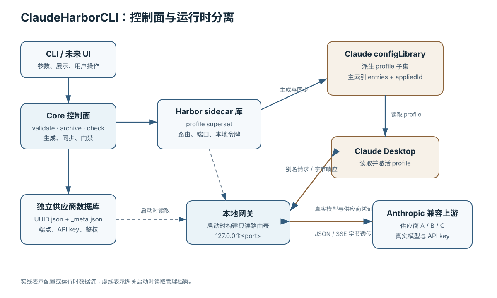
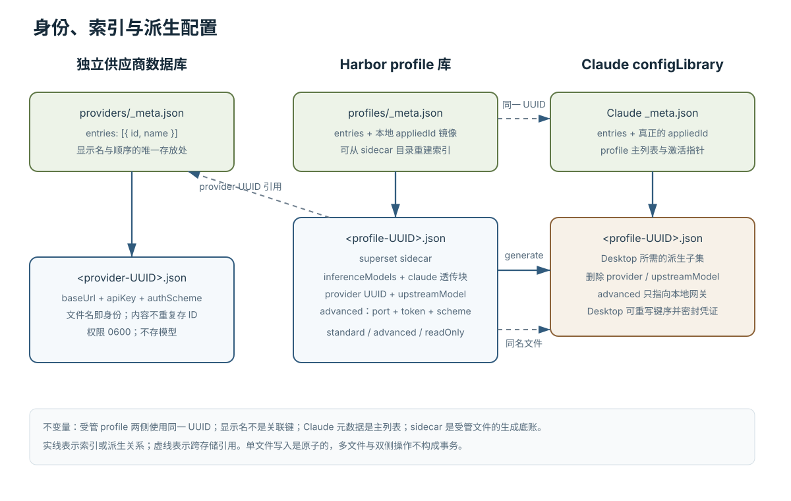
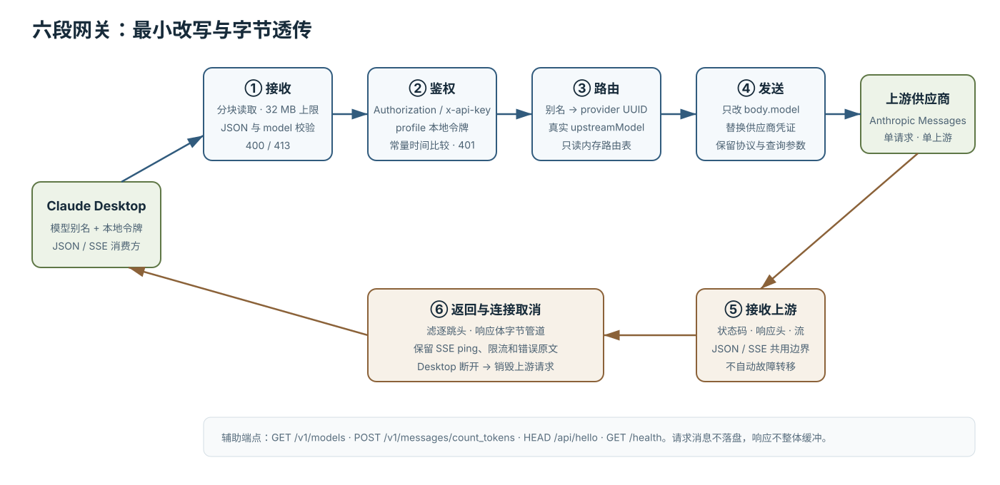
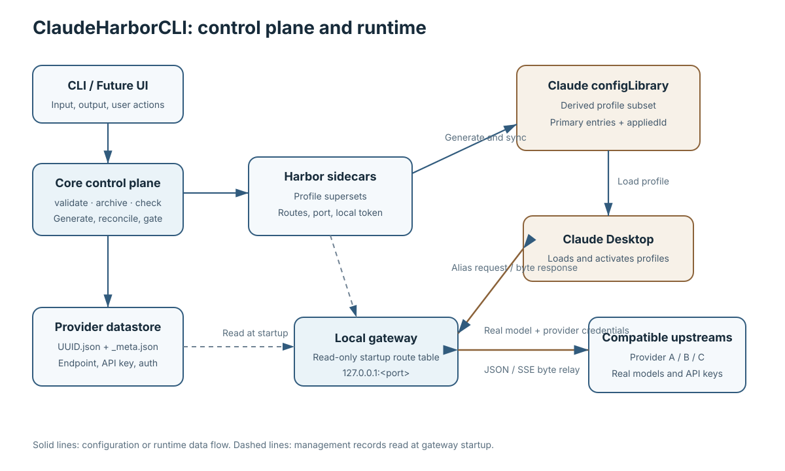
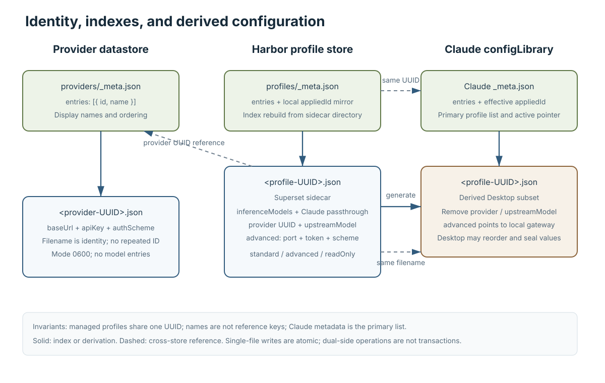
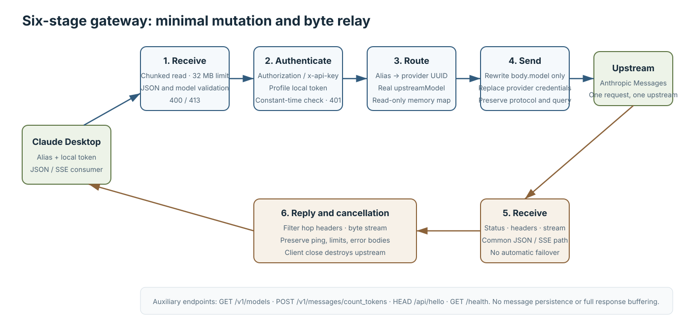

# Shipcat

**面向 Claude Desktop 的多供应商本地网关与桌面端**

**A Multi-Provider Local Gateway and Desktop App for Claude Desktop**

版本：0.2.5 · 平台：macOS / Windows · 许可证：[CC BY-NC-SA 4.0](LICENSE)

## 摘要

针对 Claude Desktop 第三方 inference profile 中供应商配置与模型条目耦合，以及多供应商路由过程中模型档位语义容易丢失的问题，本项目设计并实现了 ClaudeHarbor 内核与 Shipcat 桌面端。系统以 UUID v4 作为跨存储引用键，采用以 Claude 侧元数据为主索引的 superset 双边存储模型，并通过六段式本地网关将可读的模型档位别名映射至多个 Anthropic Messages 兼容上游。Shipcat 桌面端直接调用同一内核的公共能力，提供供应商、配置文件、用量统计与设置的可视化管理，并内置本地网关的启停与激活切换。当前实现覆盖 profile 生命周期管理、双侧一致性检查、模型发现、凭证隔离、JSON/SSE 字节透传与官方用量账本镜像。自动化测试、隔离端到端验收与 macOS 客户端联调验证了该架构在当前客户端版本下的可行性。

**关键词：** Claude Desktop；本地网关；多供应商路由；profile 管理；双边存储；UUID 引用；桌面应用

## Abstract

Shipcat pairs a desktop interface with the ClaudeHarbor kernel to address two problems in Claude Desktop third-party inference profiles: the coupling between provider configuration and model entries, and the loss of model-tier semantics during multi-provider routing. The design uses UUID v4 references, a superset dual-storage model indexed by Claude-side metadata, and a six-stage local gateway that maps readable tier aliases to multiple Anthropic Messages-compatible upstreams. The Shipcat desktop app calls the very same core APIs to manage providers, profiles, usage, and settings, and to start or stop the local gateway. The current implementation provides profile lifecycle management, dual-side consistency checks, model discovery, credential isolation, byte-preserving JSON/SSE relay, and an official usage-ledger mirror. Automated tests, isolated end-to-end verification, and macOS client integration tests demonstrate the feasibility of this architecture for the tested client version.

**Keywords:** Claude Desktop; local gateway; multi-provider routing; profile management; dual-side storage; desktop application

---

[中文](#中文) · [English](#english)

> 独立的非官方项目，与 Anthropic 没有隶属或背书关系。Shipcat 是桌面应用外壳；路由与存储内核名为 ClaudeHarbor，CLI 命令、数据目录（`~/.claudeharbor`）与 IPC 通道沿用该名称。
>
> 完整数据格式、文件管理与生命周期规则见 [ARCHITECTURE.md](ARCHITECTURE.md)；Windows 数据根发现与移植约定见 [docs/windows-port.md](docs/windows-port.md)。

## 中文

### 1. 引言

Claude Desktop 的第三方 inference gateway 能力为本地路由提供了标准入口，但 profile 文件本身主要面向客户端消费，并不适合直接承担多供应商管理所需的全部信息。真实上游模型、供应商引用、本地网关端口和路由凭证等数据如果全部写入 Claude 侧，不仅会使配置职责混杂，也会增加同步和恢复的复杂度。本项目因此将系统划分为供应商数据库、Harbor sidecar、Claude profile 和本地网关四个边界明确的组成部分，使客户端配置成为可推导、可检查的生成物，而不是所有管理信息的唯一载体。

该架构同时关注模型名称所携带的语义。对于包含子智能体和动态工作流的任务，客户端及其工作流可能依据 `haiku`、`sonnet`、`opus` 等档位选择合适的模型。如果网关把不同供应商的条目统一替换为随机标识，虽然请求仍可能被转发，模型档位与可读性却会损失。内核采用"别名即档位"的路由方式，使一个 advanced profile 能够同时容纳多家供应商、多个 API key 和任意数量的模型条目，并让条目名称继续表达其在工作流中的用途。本仓库公开的是一套已经实现并联调的具体架构，不把"本地网关"或"模型别名"等通用概念声明为独创。

### 2. 架构设计



*图 1. 控制面、双侧档案与运行时的关系。*

#### 2.1 UUID 引用与元数据组织

系统以 UUID v4 作为供应商和 profile 的稳定身份，而不是以用户可修改的显示名作为关联依据。每个供应商文件和 profile 文件的文件名都是对应 UUID，文件内容不再重复保存自身 ID；显示名、顺序和激活状态则集中在 `_meta.json` 中维护。这里的 `_meta.json` 可以理解为轻量级索引，而不是另一份完整配置副本：供应商侧的 `_meta.json` 保存 `entries` 中 UUID 与显示名的对应关系；Harbor profile 侧的 `_meta.json` 保存 profile 索引和本地 `appliedId` 镜像；Claude 侧的 `_meta.json` 则保存 Desktop 实际使用的 profile 名单与激活指针。模型条目通过供应商 UUID 引用连接信息，因此供应商改名不会引发路由级联修改，profile 改名也不会改变两侧文件的关联。对 ClaudeHarbor 管理的 profile 而言，Harbor sidecar 与 Claude `configLibrary` 中的文件使用同一个 UUID，激活、改名、删除和一致性检查都围绕这一稳定键展开，从数据结构上避免以名称匹配造成的误关联。

#### 2.2 Superset 双边存储与独立供应商数据库



*图 2. 供应商数据库、Harbor sidecar 与 Claude 派生配置之间的引用关系。*

系统为供应商建立了独立的本地数据库。这里的"数据库"是由 `~/.claudeharbor/providers/` 下的单供应商 JSON 文件和 `_meta.json` 索引组成的本地数据存储，而不是需要安装的数据库服务器。每家供应商的连接地址、API key 和鉴权方案只在该数据库中保存一份，供应商本身不绑定模型；一个供应商可以被多个 profile 和多个模型条目共同引用，删除供应商时则通过 UUID 反向检查是否仍被使用。与此相对，profile sidecar 只保存供应商 UUID 和真实上游模型名，不复制完整的供应商记录。这样的分层使"如何连接一家供应商"与"一个 profile 如何选择模型"成为两个独立问题，也使多供应商 profile 不需要围绕某一家供应商复制整份配置。

对于由 ClaudeHarbor 创建的 profile，Harbor sidecar 是生成所需的 superset：它保存路由条目、供应商 UUID、`upstreamModel`、网关端口、本地令牌以及需要传递给 Desktop 的字段；Claude profile 则是由 sidecar 推导出的客户端子集。advanced profile 在 Claude 侧只保留本地网关连接信息，真实供应商密钥留在供应商数据库中；standard profile 因 Desktop 直连上游的要求，会生成当前供应商所需的直连凭证字段，但仍不改变供应商数据库作为管理底账的地位。其目录关系如下：

```text
~/.claudeharbor/
├── providers/                     # 独立供应商数据库
│   ├── _meta.json                 # UUID、显示名与顺序索引
│   └── <provider-UUID>.json       # 单供应商端点、密钥与鉴权方案
└── profiles/
    ├── _meta.json                 # profile 索引与本地激活镜像
    └── <profile-UUID>.json        # 生成与路由所需的 superset sidecar

~/Library/Application Support/Claude-3p/configLibrary/   # macOS
%LOCALAPPDATA%\Claude-3p\configLibrary\                   # Windows（安装版）
├── _meta.json                     # Claude 主索引与 appliedId
└── <profile-UUID>.json            # 由 sidecar 推导的客户端子集
```

双边存储并不意味着两侧可以任意漂移。系统以 Claude 侧 profile 元数据作为主索引，并在激活、网关启动和状态检查前执行探测：Claude 条目消失时，本地孤儿 sidecar 会被移除；Claude 出现未关联条目时，系统建立 `readOnly` 镜像（索引存在但文件缺失的悬空条目则跳过并告警，不阻断流程）；条目仍存在但 Claude 文件缺失时，系统从 sidecar 重新推导文件。创建和条目修改会立即生成相应的 Claude 数据，激活只负责一致性检查和切换 `appliedId`，不与网关进程耦合。由此，Claude 侧决定"当前存在哪些可供客户端使用的 profile"，Harbor 侧决定"这些受管 profile 应当如何生成和路由"，两侧职责明确而又通过 UUID 保持对应。

#### 2.3 别名即档位与自由路由

路由条目包含 Desktop 可见的 `name`、供应商 UUID 和真实 `upstreamModel`。其中 `name` 是稳定、可读的客户端别名，`upstreamModel` 才是发送给供应商的真实模型标识，二者在网关中一一解析。别名可以保留 `haiku`、`sonnet`、`opus` 等档位语义，也可以通过 `labelOverride` 提供更适合用户阅读的显示名。例如，同一个 profile 可以同时包含 `claude-opus-main`、`claude-sonnet-main` 和 `claude-haiku-main`，分别指向三家供应商的不同模型；条目数量不受四个固定槽位限制，也不要求同一档位只能绑定一家供应商。为适配 Desktop 当前的模型路由校验，别名需要包含 `claude` 或 `anthropic`，不能包含会被客户端拒绝的其他厂商名，末尾不能是会被解释为日期的 8 位纯数字。该设计的目标不是伪装上游身份，而是在客户端要求的命名约束内保留工作流所需的可读档位信息，并把真实模型选择明确留在用户配置中。

```text
claude-opus-main   → 供应商 A 的 upstream-model-a
claude-sonnet-main → 供应商 B 的 upstream-model-b
claude-haiku-main  → 供应商 C 的 upstream-model-c
```

#### 2.4 六段网关链路



*图 3. 从 Desktop 请求到上游响应返回的六个逻辑阶段。*

网关采用单向、可检查的请求生命周期。除模型路由和凭证替换外，请求保持 Anthropic Messages 协议形态；响应则尽量以字节流返回，避免重新序列化破坏 SSE 事件、思考块、工具调用或上游错误细节。

**第一段：接收与请求边界。** 网关监听 `127.0.0.1:<port>`，接收 `POST /v1/messages` 和 `POST /v1/messages/count_tokens`，同时提供模型发现与连接检查所需的辅助端点。接收阶段按块读取请求体并设置 32 MB 上限，随后执行 JSON 解析和最小结构校验，要求请求体为对象且包含非空字符串 `model`。非法 JSON、缺字段或超限请求在进入路由前即被转换为 Anthropic 风格的错误响应，因此后续阶段只需要处理结构有效的推理请求。

**第二段：本地鉴权与凭证隔离。** Desktop 到本地网关使用当前 advanced profile 独立的 `gatewayToken`，它与任何真实供应商 API key 都不是同一凭证。网关优先读取 `Authorization`，兼容 Bearer 前缀和裸令牌；未提供时再读取 `x-api-key`，并使用常量时间比较降低时序侧信道风险。只有通过该校验的请求才能访问模型和推理端点。由于网关只绑定回环地址，这一层主要承担本地配置隔离和误请求防护，而不是把服务暴露为公共代理。

**第三段：别名解析与路由计划。** 网关启动时根据 sidecar 条目构建内存路由表，以客户端发来的模型别名精确查找对应条目，再通过供应商 UUID 从独立供应商数据库解析端点、密钥和鉴权方案。路由计划同时包含真实 `upstreamModel` 和目标上游地址。若别名不存在、供应商记录缺失或必要凭证为空，请求不会携带客户端令牌继续外发，而是返回明确的本地错误。该阶段把客户端命名与上游连接彻底解耦，是多供应商共存和自由增减条目的核心。

**第四段：最小请求改写与上游发送。** 命中路由后，网关只把请求体中的 `model` 改写为真实上游模型，其他消息、工具、思考、缓存和控制字段保持原有结构；URL 查询参数也会保留。发往供应商时，本地网关令牌被移除，替换为该供应商的 `x-api-key` 或 Bearer 凭证，同时透传 `anthropic-version`、`anthropic-beta` 和与 Claude 工作流有关的归因头。用户自定义头在去除托管认证头和逐跳头后加入，请求体变化后重新计算内容长度。该阶段不执行协议转换，因此上游必须原生兼容本次请求所使用的 Anthropic Messages 语义。

**第五段：上游响应接收。** 网关接受上游返回的状态码、响应头和响应流，不要求上游错误必须先转换为另一种内部模型。非流式 JSON 与流式 SSE 共用同一响应边界，上游的限流、重试和业务错误信息因此能够保留。当前版本采用单上游策略，一个请求在建立路由计划后只发送到一个供应商；连接失败或上游返回错误时不会自动切换到另一家公司，以避免在尚未定义重试语义前引入重复计费或状态不一致。

**第六段：字节返回与连接取消。** 返回阶段过滤 `connection`、`transfer-encoding` 等逐跳响应头，状态码和业务头原样交给 Desktop，同时把响应里的上游模型名换回客户端请求的路由别名。非流式 JSON 整段缓冲（上限 32 MiB）后改写顶层 `model` 并重算 `content-length`；流式 SSE 按事件块转发，只改 `message_start` 里的 `message.model`，事件边界、`ping` 和长思考心跳不受影响；上游 4xx/5xx 的错误原文保持原样。带 `content-encoding` 或超过缓冲上限的响应退回原始字节管道。若 Desktop 在响应完成前断开，网关会同步销毁上游请求，避免用户已经取消任务后仍持续消耗上游生成。

除推理链路外，`GET /v1/models` 从当前 sidecar 条目生成本地模型目录，`HEAD /api/hello` 和 base URL 的 GET/HEAD 用于连接检查，`GET /health` 则为 CLI 与桌面端提供网关存活与有效路由数量信息。

#### 2.5 一致性门禁与 profile 生命周期

双侧一致性由"现场生成期望结果，再与 Claude 实际文件比较"实现，而不是依赖另一份容易过期的状态快照。`gate()` 对标准或高级 sidecar 调用生成器，逐键比较期望 profile 与 Claude 文件：对象键序不影响结果，模型数组顺序则被认为具有语义，因为第一条可能承担默认模型职责；Desktop 自动添加的非受管字段可以被容忍，sealed 凭证只检查存在性，避免把客户端加密后的密文误判为密钥漂移。`readOnly` 镜像不参与这种生成比较，因为其定义就是保留外来配置而不是接管它。激活和网关启动都以门禁通过为前提，防止把本地修改、Claude 实际文件和运行中的路由表置于互不一致的状态。

生命周期操作围绕同一组规则闭合：创建 sidecar 时同步登记 Claude 元数据并按需生成文件，条目增删改会重新推导受管 profile，改名只更新元数据中的显示名，删除则清理双侧关联。激活仅切换 Claude `appliedId` 与本地镜像，成功或失败都不会隐式启动网关；网关的启动与停止由桌面端或 `gateway-run` 独立承担。这样的拆分使用户能够明确区分"配置是否已经激活"和"本地网关是否正在运行"。

#### 2.6 Shipcat 桌面端

Shipcat 是基于 Electron 的桌面外壳，直接调用 `core/index.ts` 的公共能力，不复制 profile 或路由业务逻辑，使 CLI 与 GUI 共享相同的一致性门禁和生命周期规则。界面与内核之间通过 `ui/shared/ipc.ts` 定义的通道契约通信，主进程（`ui/main/`）负责网关生命周期、文件对话框、天气查询与系统能力，渲染层（`ui/renderer/`）按页面模块组织：

```text
ui/
├── main/                  # Electron 主进程
│   ├── ipc.ts             # 内核 IPC 注册
│   └── services/          # 网关 / 供应商 / 档案 / 用量 / 状态 / 错误
├── renderer/              # 渲染层
│   ├── pages/             # 概览 / 供应商 / 配置文件 / 用量统计
│   ├── settings/          # 设置弹窗（常规 / 客户端信息）
│   ├── components/        # 侧栏 / 菜单 / 弹窗 / 小猫吉祥物 / i18n
│   ├── state/             # 导航 / 主题 / 侧栏 / 用户身份
│   └── greeting.ts        # 欢迎语生成（时间 / 天气 / 节日 / 小猫彩蛋）
└── shared/ipc.ts          # 通道契约
```

主要能力：概览页显示按时段问候语、建议条目与错误通知条；供应商与配置文件页提供完整的增删改查，档案页内置网关开关与激活切换；用量页同步官方账本，以热力图与按天图表（柱状/表格两种视图）呈现，悬停热力图格子可查看该时段明细；设置页包含主题（浅色 / 深色 / 跟随系统）、语言、头像、开机自启与"关闭窗口后驻留后台"开关。欢迎区每小时轮换一只像素小猫，点击可触发眨眼或摇尾巴动画。

打包使用 electron-builder：`npm run pack` 产出未压缩目录便于检查，`npm run dist` 产出 macOS 的 dmg/zip 与 Windows 的 NSIS 安装包。

### 3. 运行模式与数据边界

`standard` 模式用于单供应商直连，模型名称不经过本地网关改写，适合上游本身能够处理对应模型名的场景；`advanced` 模式用于多供应商、多模型条目的显式路由，每个别名对应一个确定的真实上游模型；`readOnly` 模式则用于接纳并非由 ClaudeHarbor 创建的 Claude profile，系统可以读取、展示或删除它，但不会尝试编辑未知字段或推导出可能破坏原配置的内容。三种模式共享供应商与 profile 的 UUID 组织方式，但只有 advanced 模式需要运行本地网关。当前版本以 profile 级配置为边界，不管理 Claude Desktop 的应用级配置，也不自动执行官方模式恢复。

### 4. 安全模型与故障边界

系统的主要安全边界是本机文件权限、回环监听和凭证用途分离。供应商密钥文件使用 `0600` 权限，CLI 对供应商 key 和 advanced sidecar 的 `gatewayToken` 打码；advanced profile 写入 Claude 侧的是本地网关令牌，而非全部上游密钥；网关不记录完整请求体，也不把 Desktop 的本地认证头转发给供应商。需要特别注意的是，当前 CLI 通过命令行参数接收供应商密钥，shell 历史和进程列表仍可能暴露命令参数，因此现阶段应把密钥输入方式视为安全模型的已知限制，而不能仅凭文件权限判断整个链路已经消除泄露风险。桌面端通过本机 IPC 调用内核，不引入新的网络暴露面。

按当前本机威胁模型，一致性 diff 在 `inferenceGatewayApiKey` 缺失、或未密封且与期望不同时仍可能显示明文值，这是保留的本地诊断行为；不要把 `profile check`、`activate` 或 `gateway-run` 的原始输出粘贴到公开位置。`profile show` 会遮盖 advanced `gatewayToken` 以及所有 `inferenceCustomHeaders` 的值。

故障处理遵循"尽早拒绝、原样返回"的原则。本地校验、鉴权、路由和连接错误使用明确的 Anthropic 风格错误信封；已经进入上游响应阶段的错误则不再重新包装。当前版本没有自动故障转移、重试和超时策略，也没有配置备份。这些选择降低了初版状态机的复杂度，但意味着上游长时间无响应、限流或失效时仍需要用户介入，后续优化不能只增加重试代码，还必须同时定义请求取消、重复生成和费用责任等语义。

### 5. 验证方法

验证分为纯函数测试、文件系统测试、真实 socket 集成测试、隔离安装验收和 macOS 客户端联调。纯函数与文件系统测试覆盖 UUID 索引、原子写入、权限、校验和双侧生命周期；网关测试使用本地假上游检查鉴权、模型改写、查询保留、JSON/SSE 透传、错误矩阵和客户端断连；隔离安装验收通过安装后的 `claudeharbor` 命令完成双供应商建库、profile 创建、路由添加、激活、模型发现和实际 HTTP 转发。当前测试命令包含 428 项用例，macOS 上 424 项通过、0 项失败、4 项跳过；类型检查无错误。真机联调已覆盖模型发现、真实对话、多供应商调用、工作流子智能体以及按"最便宜"要求选择 haiku 档位的行为，但这些结论仍受当前 Claude Desktop 版本约束，客户端升级后应重新验证。Windows 侧的路径探测、`%APPDATA%` 壳判定、权限降级与 rename 重试已由隔离测试覆盖，真机验收项见 [docs/windows-port.md](docs/windows-port.md)。

### 6. 后续优化空间

**可靠性与缓存亲和。** 当前不做跨供应商自动故障转移。不同供应商或模型通常具有不同的上下文缓存、计费语义和输出轨迹；切换候选会让长上下文缓存失效，并可能让用户承担高于一次原生错误的成本。上游错误以状态码和响应体原样返回，保留 Desktop 既有的重试与提示逻辑。后续可靠性优化应优先做本地连接检查、错误分类、用量统计与供应商健康展示，而不是隐藏切换。

**可观测性与用量归因。** 网关已经透传会话、智能体和工作流相关请求头，后续可以在不记录提示词和密钥的前提下建立请求级指标，包括别名、真实上游、延迟、输入输出 token、缓存命中和取消原因。该能力可以进一步形成按 profile、供应商或工作流聚合的本地用量视图，并为供应商健康和成本选择提供数据依据。

**凭证与生命周期体验。** 供应商密钥输入可以改为隐藏式交互或系统钥匙串，减少命令行参数暴露；配置备份、官方模式恢复和更细粒度的外来 profile 接管也值得形成明确的用户操作流程。对于 Desktop 自动 sealed 的字段，还需要持续验证不同客户端版本下的读写边界，避免把"可比较"误扩展为"可以解密或复用"。

**平台与协议扩展。** v0.1.2 已引入统一的平台层，收敛 macOS 与 Windows 的路径计算、Claude-3p 数据根探测、`--claude-root` 覆盖、权限降级与 rename 重试（规则与验收清单见 [docs/windows-port.md](docs/windows-port.md)）；Windows 真机上的 Desktop 联调、ACL 与杀毒软件共存仍需逐项确认，桌面端在 Windows 上还需要托盘支持才能完整覆盖"驻留后台"场景。协议转换如果未来纳入路线，也应作为独立适配器层置于原生 Anthropic Messages 主链路之外，明确字段能力损失和测试矩阵，而不改变当前"只改模型与凭证、响应字节透传"的核心约束。

### 附录 A：安装与最小使用示例

要求：macOS 或 Windows、Node.js 22.18 或更高版本、支持第三方 inference gateway 的 Claude Desktop。

零运行时依赖，因此运行 CLI **不需要 `npm install`**。从 GitHub 获取代码：

```bash
git clone https://github.com/SH082150/Shipcat.git
cd Shipcat
```

**桌面端（开发模式）**：首次开发先 `npm ci` 安装 Electron、TypeScript 等开发依赖，然后：

```bash
npm run dev        # 构建并启动 Shipcat 桌面端
```

**打包发布产物**：

```bash
npm run pack       # 产出未压缩的应用目录（release/，便于检查）
npm run dist       # macOS: dmg + zip；Windows: NSIS 安装包
```

**CLI**：两种方式任选其一——

```bash
# 方式一：不安装，macOS / Windows 使用同一条命令
node bin/claudeharbor.ts --help
node bin/claudeharbor.ts status

# 方式二：装成全局命令 claudeharbor，之后在任何目录可用
npm install -g .
claudeharbor --help
```

换电脑或移动仓库目录不需要修改源码：在仓库根目录用 `node bin/claudeharbor.ts` 运行，数据根按当前用户和操作系统计算。Windows 上先运行 `node bin/claudeharbor.ts paths` 核对采用值，自动探测失败时用 `--claude-root <Claude-3p 目录>` 指定。不要提交真实的 `~/.claudeharbor`、Claude-3p 数据目录或 Usage 镜像；它们包含密钥、用户路径或使用记录。

建议先完全退出 Claude Desktop。以下地址、模型名和密钥均为示例，请替换为实际配置：

```bash
node bin/claudeharbor.ts provider add first https://api.example.com/anthropic '<API_KEY_1>' x-api-key
node bin/claudeharbor.ts provider add second https://api.example.org/anthropic '<API_KEY_2>' bearer
node bin/claudeharbor.ts profile create MyGateway --mode advanced --port 8787 --token '<LOCAL_TOKEN>' --auth-scheme bearer
node bin/claudeharbor.ts profile route-add MyGateway --name claude-sonnet-main --provider first --upstream upstream-model-a --label '主力模型' --tier sonnet
node bin/claudeharbor.ts profile route-add MyGateway --name claude-haiku-main --provider second --upstream upstream-model-b --label '快速模型' --tier haiku
node bin/claudeharbor.ts profile check MyGateway
node bin/claudeharbor.ts activate MyGateway
node bin/claudeharbor.ts gateway-run MyGateway
```

保持 `gateway-run` 所在终端运行，然后启动 Claude Desktop 并选择已激活的 profile。`activate` 只切换配置，不启动网关；按 `Ctrl-C` 停止网关。使用桌面端时，网关的启停与激活切换可在档案页直接完成。

### 附录 B：命令接口

Windows 上用 `node bin/claudeharbor.ts paths` 查看数据根候选与采用值；自动探测失败时，在子命令前加
`--claude-root <Claude-3p 目录>` 手工指定（详见 [docs/windows-port.md](docs/windows-port.md)）。

```text
claudeharbor provider add <名称> <baseUrl> <密钥> [x-api-key|bearer]
claudeharbor provider list
claudeharbor provider rename <旧名> <新名>
claudeharbor provider remove <名称>

claudeharbor profile create <名称> --mode standard|advanced [--port <端口> --token <口令> --auth-scheme <方案>]
claudeharbor profile list
claudeharbor profile show <id或名>
claudeharbor profile import <UUID>
claudeharbor profile check <id或名>
claudeharbor profile remove <id或名>
claudeharbor profile route-add <profile> --name <别名> --provider <供应商名> [--upstream <真模型> --label <显示名> --tier <档位> --behaves-as <模型>]
claudeharbor profile route-remove <profile> <别名>
claudeharbor profile route-update <profile> <别名> [--label <显示名> --tier <档位> --upstream <真模型> --provider <供应商名>]

claudeharbor activate <id或名>
claudeharbor gateway-run <id或名>
claudeharbor status
claudeharbor paths

claudeharbor usage sync
claudeharbor usage query [--day <日期>] [--from <日期>] [--to <日期>] [--surface <chat|code|cowork>] [--origin <turn|title|connection_probe>] [--model <模型名>]
```

### 附录 C：Core API

所有公共内核能力从 `core/index.ts` 导出，CLI 与桌面端共用同一入口。

| 导出 | 主要函数/内容 | 作用 |
|---|---|---|
| 类型导出 | `Provider`、`HarborProfile`、`ModelEntry`、`MetaEntry` 等 | 领域类型 |
| `platform` | `resolveHome()`、`desktopDataRoot()`、`desktopDataRootCandidates()`、`localAgentSessionsRoot()`、`inspectDesktopRoots()`、`harborRoot()`、`claudeCodeRoot()` | 平台路径解析与 Claude-3p 数据根探测 |
| `paths` | `harborPaths()`、`claudePaths()` | 统一计算两侧文件路径 |
| `fs` | `atomicWriteJson()`、`readJson()` | 原子 JSON 写入、权限控制与读取 |
| `providers` | `add()`、`list()`、`getByName()`、`getById()`、`rename()`、`remove()`、`metaRebuild()` | 独立供应商数据库与 UUID 索引 |
| `profiles` | `create()`、`list()`、`detailList()`、`get()`、`remove()`、`rename()`、`addEntry()`、`updateEntry()`、`removeEntry()`、`importFromClaude()`、`meta()` | profile、路由条目和双侧生命周期 |
| `generate` | `generateDesktopProfile()` | 从 sidecar 推导 Claude profile |
| `claudeMeta` | `read()`、`upsertEntry()`、`removeEntry()`、`apply()`、`syncNames()` | 维护 Claude 主索引与激活指针 |
| `check` | `gate()`、`scan()` | 一致性门禁与三情形自动处置 |
| `validate` | `validateRouteId()`、`validateProviderName()`、`validateBaseUrl()`、`validateStandardProviders()`、`validatePort()`、`validateGatewayToken()`、`validateGatewayAuthScheme()` | 写入前校验 |
| `gateway` | `startGateway()` | 启动本地网关并返回关闭句柄 |
| `usage` | `syncLedger()`、`aggregateUsage()` | 官方 usage-ledger 镜像同步与按天聚合查询 |

开发验证（首次开发先运行 `npm ci` 安装开发依赖；只运行 CLI 可跳过）：

```bash
npm test
npm run typecheck
```

### 更新日志

#### v0.2.5

- 用量页：停留期间每 5 秒同步一次本机账本，有新记录才重绘（悬停格子时让位，避免打断查看）；窗口重新获得焦点时立即刷新。热力图右侧日期改为当前日期。

#### v0.2.4

- 后台静默运行：新增菜单栏托盘（显示 / 退出），系统页可隐藏 Dock 图标（Windows 为隐藏任务栏图标）；关闭窗口后驻留后台的开关现在会持久保存，重启不再丢失。
- 找回机制：再次启动应用会唤回原有窗口，不会启动第二个实例；托盘创建失败时不会隐藏 Dock，避免应用无法找回。
- 头像：选择图片后支持拖动与缩放裁剪，输出 512×512 头像；可选图片上限从 2MB 放宽到 8MB。
- 档案页：整体放宽间距（表单行、节间距、模型行与表格行高），页头与当前使用卡之间留白加大。
- 用量页：总使用量卡新增缓存命中率（保留两位小数），并与热力图严格等高。

#### v0.2.3

- 用量页改版：热力图右侧新增与图等高的总使用量卡（输入 / 输出 / 缓存读 / 调用次数 / 网页搜索），悬停格子即切换为该时段明细；新增"按天用量"图表（7 / 30 / 90 天，柱状与表格两种视图，悬停显示分类明细）；移除底部额度区与设置页相关入口。
- 维护性清理：移除死工具函数、不可达的排序与开关事件链路、约 180 条零引用 CSS 规则与 65 个孤儿 i18n 文案；设置页删除未接线的"侧边栏用量""系统通知"与存储管理按钮。
- 文案：错误信息不再直接透出内部异常原文；鉴权方案、档案类型等枚举值改为中文用户文案；统一"档案 / 供应商 / 网关路由"术语。

#### v0.2.1

- 档案页：模型与 Claude 透传的“添加”按钮统一到标题行右侧；透传改为行内“项/值”草稿，支持任意键名，值按 JSON 解析。
- 网关：回程把响应中的上游模型名写回客户端请求的别名，非流式 JSON 与 SSE 均覆盖，事件边界与 ping 保持原样。
- 双端同步：监听 Claude 配置目录，巡检漂移；概览新增“检查档案配置”建议，档案列表标记“待同步”，编辑页弹出设置页同款的“需要同步”浮窗并锁定表单，处理完才允许编辑。
- 修复：编辑已有档案时“添加模型”无响应；档案名称含空白字符时的误报。

#### v0.2.0

- 新增 Shipcat 桌面端（Electron）：概览、供应商、配置文件、用量统计四个管理页与设置弹窗，内置网关启停、激活切换、主题、语言、开机自启与"关闭窗口后驻留后台"开关；欢迎区提供按小时轮换的像素小猫与多类别问候语。
- 新增 electron-builder 打包配置：`npm run pack` / `npm run dist` 产出 macOS（dmg/zip）与 Windows（NSIS）安装包，应用图标为项目自有的小猫像素形象。
- 界面与内核通过 `ui/shared/ipc.ts` 通道契约通信，渲染层按页面模块分文件组织；CLI 保持不变。

#### v0.1.2

- 新增 Windows 支持：平台层统一 macOS 与 Windows 的路径计算与 Claude-3p 数据根探测。安装版采用 `%LOCALAPPDATA%\Claude-3p`，商店版（MSIX）扫描 `Packages\Claude*\LocalCache\Roaming\Claude-3p`；`%APPDATA%\Claude-3p` 仅作为候选，并按是否含 `configLibrary` / `local-agent-mode-sessions` 择优。
- 新增 `claudeharbor paths` 诊断命令与全局选项 `--claude-root <目录>`（环境变量 `CLAUDEHARBOR_CLAUDE_ROOT`），用于自动探测失败时手工指定数据根。
- Windows 上 POSIX 权限位无对等物：写入层静默跳过 `chmod`，密钥文件依赖用户目录继承的 NTFS ACL；`rename` 在杀毒软件或索引服务占用时做有限重试。
- 测试夹具改为经 `claudePaths()` / `officialLedgerRoot()` 计算 Claude 侧路径，不再硬编码 `Library/Application Support`。数据根规则、权限降级与真机验收清单见 [docs/windows-port.md](docs/windows-port.md)。

#### v0.1.1

- 新增 Usage 模块：镜像 Claude Desktop 3p 官方用量账本（usage-ledger）到 `~/.claudeharbor/usage/ledger/`，支持增量同步与按天/界面/模型聚合查询（含官方估价累加），为用量热力图提供数据。
- 说明：同步只读官方账本文件、逐字节原样镜像，不解析会话 JSONL。

### 许可证

[CC BY-NC-SA 4.0](LICENSE)（署名-非商业性使用-相同方式共享）

## English

**Version: 0.2.5 · Platforms: macOS / Windows · License: [CC BY-NC-SA 4.0](LICENSE)**

### 1. Introduction

Claude Desktop's third-party inference gateway provides an entry point for local routing, but its profile files are primarily intended for client consumption rather than complete multi-provider administration. The project therefore separates the provider datastore, Harbor sidecars, generated Claude profiles, and the local gateway. The Claude profile becomes a derivable and checkable artifact, while routing credentials, upstream model names, and provider references remain in the management layer. Shipcat, the Electron desktop app, exposes all of this through the same public core APIs.

The architecture also treats model names as workflow semantics. In agentic and dynamic workflows, tier names such as `haiku`, `sonnet`, and `opus` can influence model selection. Replacing every route with an opaque identifier may preserve connectivity while discarding that information. The kernel instead keeps readable tier aliases and allows one advanced profile to contain multiple providers, credentials, and any number of explicit model routes. This repository publishes a concrete implementation and does not claim general gateway or aliasing concepts as unique inventions.

### 2. Architecture



*Figure 1. Relationships among the control plane, dual-side archives, and runtime.*

#### 2.1 UUID references and metadata

UUID v4 is the stable identity of every provider and profile. Filenames carry these identifiers, while `_meta.json` files act as lightweight indexes rather than complete configuration copies. Provider metadata maps UUIDs to display names; Harbor profile metadata holds the local profile index and an `appliedId` mirror; Claude metadata holds the client-visible profile list and active pointer. Routes reference providers by UUID, so renaming a provider or profile does not change its identity or require cascading route edits. Managed sidecars and generated Claude profiles share the same profile UUID, giving activation, renaming, deletion, and consistency checks one unambiguous association key.

#### 2.2 Superset dual storage and the independent provider datastore



*Figure 2. References among the provider datastore, Harbor sidecars, and derived Claude profiles.*

Providers live in an independent local datastore under `~/.claudeharbor/providers/`. It consists of one JSON document per provider and a `_meta.json` index, not an external database server. Each record stores an endpoint, API key, and authentication scheme once, without binding the provider to a model. Profiles and model entries reference that record by UUID, and provider deletion is rejected while references remain. Connection management is therefore independent from model selection, and multi-provider profiles do not need to duplicate complete provider configurations.

For managed profiles, the Harbor sidecar is the generation superset: it contains provider UUIDs, upstream model names, gateway settings, local credentials, and Desktop-bound fields. The generated Claude profile is the client-facing subset. Advanced profiles expose only local gateway credentials to Claude, while standard profiles include the direct-provider credentials required by Desktop. Claude-side metadata is the primary profile index. Reconciliation removes local sidecars whose Claude entries disappear, imports unknown entries as `readOnly` mirrors, and regenerates missing managed Claude files. Creation and route edits derive Claude data immediately; activation checks consistency and changes `appliedId` without starting the gateway.

#### 2.3 Aliases as tiers and unrestricted route counts

Each route separates the Desktop-visible `name` from the real `upstreamModel`. Readable aliases can preserve `haiku`, `sonnet`, or `opus` semantics, while `labelOverride` supplies a user-facing display label. A profile may define multiple providers and more than four entries; a tier is not restricted to one fixed supplier slot. To satisfy current Desktop route validation, aliases must contain `claude` or `anthropic`, must not contain rejected vendor identifiers, and must not end with eight digits that could be interpreted as a date. The intent is not to conceal the upstream identity, but to preserve workflow-relevant tier information within client naming constraints while leaving real model selection explicit in user configuration.

#### 2.4 Six-stage gateway



*Figure 3. Six logical stages from a Desktop request to the upstream response.*

**Receive and validate.** The loopback server accepts Messages and count-tokens requests, reads bodies in chunks with a 32 MB limit, parses JSON, and requires a non-empty string `model`. Malformed or oversized requests fail before routing with an Anthropic-shaped error.

**Authenticate locally.** The profile-specific `gatewayToken` is independent of every upstream API key. The gateway accepts `Authorization` first and then `x-api-key`, using constant-time credential comparison. This isolates client-to-gateway authentication from gateway-to-provider authentication.

**Resolve the route.** An in-memory table resolves the exact model alias to a provider UUID and `upstreamModel`, then resolves the provider record to an endpoint and credentials. Missing aliases, provider records, or required credentials fail locally without sending the client token upstream.

**Send with minimal mutation.** Only the request body's `model` is rewritten. Messages, tools, thinking, caching, and other protocol fields retain their structure, and URL query parameters are preserved. Local credentials are replaced with the selected provider's authentication header, while Anthropic protocol and workflow-attribution headers are forwarded according to the managed-header rules. No protocol translation is performed.

**Receive the upstream response.** Status, headers, JSON bodies, and SSE streams enter a common response path without mandatory conversion into an internal message model. The current release deliberately chooses one upstream per request and does not retry another provider after failure, avoiding undefined duplicate-generation and billing behavior.

**Relay bytes and cancellation.** The return path removes hop-by-hop headers and streams the remaining response without reparsing its body. SSE event boundaries, `ping` frames, rate-limit metadata, and upstream error bodies remain intact. If Desktop disconnects, the gateway destroys the upstream request to avoid continued generation after cancellation.

Model discovery is generated from sidecar entries through `GET /v1/models`; connection probes and `GET /health` provide client and CLI checks outside the inference path.

#### 2.5 Consistency and lifecycle

The consistency gate generates the expected Claude profile from the current sidecar and compares it with the actual file. Object key order is ignored, model-array order remains significant, unmanaged Desktop additions are tolerated, and sealed credentials are checked for presence rather than compared as plaintext. `readOnly` mirrors are excluded because they do not have a managed generation expectation.

Creation, route edits, renaming, deletion, activation, and gateway startup have separate responsibilities. Activation changes the active pointer only; the gateway's runtime is managed independently by the desktop app or `gateway-run`. This separation prevents configuration state and process state from being conflated.

#### 2.6 The Shipcat desktop app

Shipcat is an Electron shell that calls the public APIs of `core/index.ts` directly instead of duplicating profile or routing logic, so the CLI and the GUI share the same consistency gates and lifecycle rules. The UI and the kernel communicate through the channel contract in `ui/shared/ipc.ts`; the main process (`ui/main/`) owns the gateway lifecycle, file dialogs, weather queries, and system capabilities, while the renderer (`ui/renderer/`) is organized by page module: overview, providers, profiles, usage, settings, shell components (sidebar, menus, dialogs, a pixel-art kitten mascot), navigation/theme state, and a greeting generator that rotates time-, weather-, holiday-, and kitten-themed greetings. The overview page shows time-based greetings, suggestions, and an error banner; the providers and profiles pages offer full CRUD, and the profiles page hosts the gateway toggle and activation switching. The usage page syncs the official ledger and presents it as a heatmap plus a per-day chart (bar or table view), with per-cell detail on hover. Settings include theme (light / dark / system), language, avatar, launch-at-login, and "keep running after window close". The welcome area rotates an hourly pixel kitten that blinks or wags its tail when clicked. Packaging uses electron-builder (`npm run pack` for an unpacked directory, `npm run dist` for macOS dmg/zip and Windows NSIS installers).

### 3. Modes and boundaries

`standard` provides direct single-provider access without model rewriting, `advanced` provides explicit multi-provider gateway routes, and `readOnly` represents an external Claude profile that can be viewed or deleted but not edited. Only advanced profiles require a running gateway. This release manages profile-level configuration only and does not manage app-level settings or provide a one-command official-mode restore.

### 4. Security and failure boundaries

Provider files use mode `0600`, CLI output masks provider keys and the advanced sidecar `gatewayToken`, the gateway listens only on `127.0.0.1`, and local gateway tokens are separated from upstream credentials. Full request bodies and provider keys are not logged. However, provider keys are currently accepted as command-line arguments, so shell history and process listings remain a known exposure channel. File permissions alone do not remove that risk. The desktop app adds no new network exposure: it talks to the kernel over local IPC.

Under the current local-machine threat model, consistency diffs may still expose `inferenceGatewayApiKey` when it is missing, or unsealed and different from the expected value. This local diagnostic behavior is retained intentionally; do not paste raw output from `profile check`, `activate`, or `gateway-run` into public locations. `profile show` redacts the advanced `gatewayToken` and every value in `inferenceCustomHeaders`.

Local validation and routing failures produce explicit Anthropic-shaped errors; upstream error responses are relayed without repackaging. This release has no automatic failover, retry, or timeout policy, and no configuration backup; failures remain visible so Desktop can use its native recovery behavior.

### 5. Verification

Verification covers pure functions, filesystem behavior, real-socket gateway integration, isolated installation, and macOS client integration. Tests exercise UUID indexes, atomic writes, permissions, lifecycle reconciliation, authentication, model rewriting, query preservation, JSON/SSE relay, error handling, and client cancellation. The isolated installation test uses the installed CLI to configure two providers, create and activate a profile, discover models, and forward a real HTTP request to a local fake upstream. The current suite reports 428 tests: 424 pass with four skipped and zero failures on macOS; type checking completes without errors. Client integration has covered model discovery, conversation, multiple providers, workflow subagents, and haiku-tier selection, but compatibility remains tied to the tested Claude Desktop version. Windows data-root discovery, `%APPDATA%` shell detection, permission degradation, and rename retries are covered by isolated tests; the real-machine checklist is in [docs/windows-port.md](docs/windows-port.md).

### 6. Future work

The design intentionally avoids automatic failover across providers. Different upstreams usually have different context caches, billing behavior, and output trajectories; switching routes can discard a long context cache and cost more than returning the native error once. Reliability work should therefore prioritize connection checks, error classification, usage reporting, and provider health visibility rather than hiding upstream failures. Credential entry could move to hidden prompts or the system keychain, while backup and official-mode restoration could make lifecycle operations easier to reverse. The platform layer introduced in v0.1.2 centralizes macOS and Windows path resolution, Claude-3p data-root discovery, `--claude-root` overrides, permission degradation, and rename retries (see [docs/windows-port.md](docs/windows-port.md)); real-machine Desktop integration, ACL behavior, and antivirus coexistence on Windows still need item-by-item confirmation, and the Windows build of the desktop app still needs tray support to fully cover the background-resident scenario. Any future protocol translation should remain a separate adapter layer outside the native Anthropic Messages path.

### Appendix: installation and development

Requirements: macOS or Windows, Node.js 22.18+, and a Claude Desktop version with third-party inference gateway support.

There are no runtime dependencies, so `npm install` is not needed to run the CLI. Clone the repository:

```bash
git clone https://github.com/SH082150/Shipcat.git
cd Shipcat
```

**Desktop app (development)**: run `npm ci` once to install Electron, TypeScript, and other development dependencies, then:

```bash
npm run dev        # build and launch the Shipcat desktop app
```

**Packaged releases**:

```bash
npm run pack       # unpacked app directory (release/, for inspection)
npm run dist       # macOS: dmg + zip; Windows: NSIS installer
```

**CLI** — two equivalent options:

```bash
# Option 1: no installation, same command on macOS / Windows
node bin/claudeharbor.ts --help
node bin/claudeharbor.ts status

# Option 2: install as the global `claudeharbor` command
npm install -g .
claudeharbor --help
```

Moving to another computer or repository directory requires no source changes: run `node bin/claudeharbor.ts` from the repository root, and data roots are derived for the current user and OS. On Windows, run `node bin/claudeharbor.ts paths` first and use `--claude-root <Claude-3p directory>` if auto-detection fails. Never commit a real `~/.claudeharbor`, Claude-3p data directory, or Usage mirror; they contain credentials, user paths, or usage records.

Quit Claude Desktop before changing profiles. After configuring providers and routes, run `claudeharbor profile check <profile>`, `claudeharbor activate <profile>`, and `claudeharbor gateway-run <profile>`. Keep the gateway terminal running while using an advanced profile. With the desktop app, gateway start/stop and activation switching are available directly on the profiles page. Public core APIs are exported through `core/index.ts`: `platform`, `paths`, `fs`, `providers`, `profiles`, `generate`, `claudeMeta`, `check`, `validate`, `gateway`, and `usage`.

For development, run `npm ci` once to install development dependencies; this is unnecessary when only running the CLI.

```bash
npm test
npm run typecheck
```

### Changelog

#### v0.2.5

- Usage: the page now syncs the local ledger every 5 seconds while open and redraws only when new records arrive (hovered cells are left untouched); regaining window focus refreshes immediately. The date next to the heatmap now shows the current date.

#### v0.2.4

- Background mode: a menu bar tray (show / quit) and a Hide Dock icon switch on the System page (Hide taskbar icon on Windows); "keep running after closing the window" is now persisted across launches.
- Recovery: launching the app again brings the existing window forward instead of starting a second instance; if the tray cannot be created, the Dock icon is never hidden.
- Avatar: picked images can be dragged and zoomed before cropping to a 512×512 avatar; the size limit rises from 2 MB to 8 MB.
- Profiles: overall spacing loosened (form rows, section gaps, model rows, table row height), with more breathing room between the page header and the active-profile card.
- Usage: the total-usage card gains a cache hit rate (two decimals) and stays exactly as tall as the heatmap.

#### v0.2.3

- Usage page rework: a total-usage card as tall as the heatmap now sits on its right (input / output / cache read / request count / web searches), switching to that cell's detail on hover; a new "tokens per day" chart offers 7 / 30 / 90-day ranges with bar and table views and hover breakdowns; the quota section and its settings entries are removed.
- Maintenance: removed dead utility exports, unreachable sort/toggle event chains, about 180 orphaned CSS rules, and 65 unused i18n strings; the settings page drops the unwired "usage in sidebar", "notifications", and storage-manage entries.
- Copy: internal error text no longer surfaces raw exceptions; enum values such as auth scheme and profile type now render as user-facing labels; terminology unified to "profile / provider / gateway routing".

#### v0.2.1

- Profiles: model and Claude-passthrough "add" actions moved to the section header; passthrough is now an inline key/value draft with arbitrary keys and JSON-parsed values.
- Gateway: the response model name is rewritten back to the client-requested alias for both buffered JSON and SSE, while event boundaries and ping frames stay intact.
- Two-way sync: watches the Claude config directory, reports drift, adds a "Check profile sync" suggestion on Overview, marks affected profiles as "Sync needed", and locks the edit form behind a settings-style "Sync needed" dialog until resolved.
- Fixed: "Add model" doing nothing when editing an existing profile; false whitespace errors in profile names.

#### v0.2.0

- Added the Shipcat desktop app (Electron): overview, providers, profiles, and usage pages plus a settings modal, with built-in gateway start/stop, activation switching, theme, language, launch-at-login, and background-resident switches; the welcome area rotates an hourly pixel-art kitten with multi-category greetings.
- Added electron-builder configuration: `npm run pack` / `npm run dist` produce macOS (dmg/zip) and Windows (NSIS) installers with the project's own pixel-cat icon.
- The UI talks to the kernel through the channel contract in `ui/shared/ipc.ts`; the CLI is unchanged.

#### v0.1.2

- Added Windows support: the platform layer now centralizes path resolution and Claude-3p data-root discovery for both platforms. The installer build uses `%LOCALAPPDATA%\Claude-3p`, the Store/MSIX build is discovered by scanning `Packages\Claude*\LocalCache\Roaming\Claude-3p`, and `%APPDATA%\Claude-3p` is treated as a candidate ranked by the presence of `configLibrary` / `local-agent-mode-sessions`.
- Added the `claudeharbor paths` diagnostic command and the global `--claude-root <dir>` option (environment variable `CLAUDEHARBOR_CLAUDE_ROOT`) for overriding auto-detection.
- On Windows, POSIX permission bits have no equivalent: the write layer skips `chmod` silently and secret files rely on inherited NTFS ACLs; `rename` retries briefly when antivirus or indexing services hold a target.
- Test fixtures now derive Claude-side paths via `claudePaths()` / `officialLedgerRoot()` instead of hard-coding `Library/Application Support`. Discovery rules, permission degradation, and the real-machine verification checklist are documented in [docs/windows-port.md](docs/windows-port.md).

#### v0.1.1

- Added the Usage module: mirrors the Claude Desktop 3p official usage ledger (usage-ledger) into `~/.claudeharbor/usage/ledger/`, with incremental sync and per-day / surface / model aggregation (including official cost accumulation), laying the data foundation for the usage heatmap.
- Note: sync reads only the official ledger files and mirrors them byte-for-byte; it never parses session JSONL.

### License

[CC BY-NC-SA 4.0](LICENSE) (Attribution-NonCommercial-ShareAlike)
